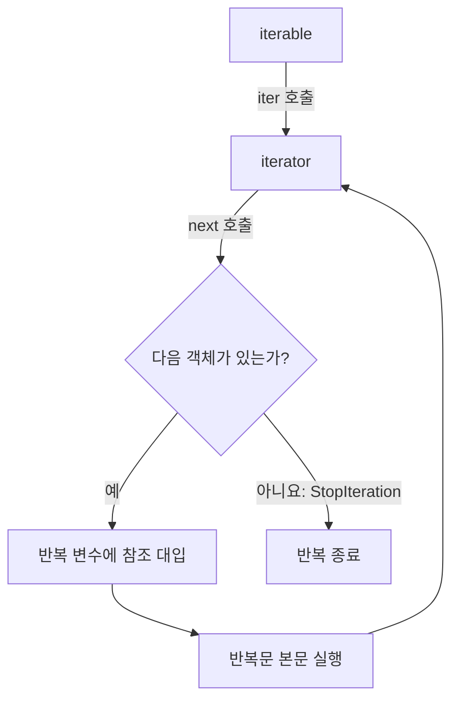
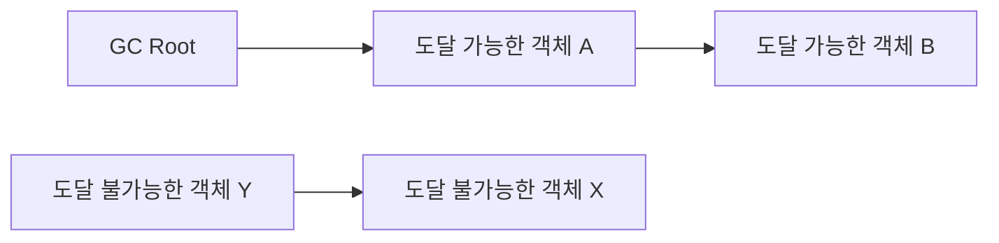

# Python과 Java의 `for`문 및 메모리 동작

## 1. 먼저 알아야 할 세 가지 개념

`for`문 안에서 만든 변수가 반복문 이후에도 존재하는지를 이해하려면 다음 개념을 구분해야 한다.

| 개념 | 의미 |
|---|---|
| 스코프(scope) | 코드에서 변수 이름을 사용할 수 있는 범위 |
| 수명(lifetime) | 변수나 객체가 실행 중 존재하는 기간 |
| 도달 가능성(reachability) | 실행 중인 코드에서 어떤 객체에 참조를 따라 도달할 수 있는지 여부 |

스코프가 끝났다고 해서 객체가 그 순간 반드시 메모리에서 삭제되는 것은 아니다. 반대로 메모리에 어떤 값이 남아 있더라도 언어 규칙상 그 변수 이름으로 접근하지 못할 수 있다.

---

## 2. Python과 Java의 `for`문 차이

### Python: `for`문은 별도의 스코프를 만들지 않는다

```python
for i in range(3):
    value = i * 10

print(i)      # 2
print(value)  # 20
```

`i`와 `value`는 `for`문만의 변수가 아니라, 이 코드가 실행 중인 모듈 또는 함수의 지역 변수다. 따라서 반복문이 끝난 뒤에도 같은 스코프 안에서 사용할 수 있다.

다만 대입문이 한 번도 실행되지 않았다면 변수는 만들어지지 않는다.

```python
for item in []:
    value = item

print(value)  # NameError: name 'value' is not defined
```

### Java: `{ }` 블록이 별도의 스코프를 만든다

```java
for (int i = 0; i < 3; i++) {
    int value = i * 10;
}

System.out.println(i);      // 컴파일 오류
System.out.println(value);  // 컴파일 오류
```

`i`와 `value`는 `for`문의 블록 안에서만 사용할 수 있다. 블록 밖에서도 값을 사용하려면 바깥에서 변수를 선언해야 한다.

```java
int value = 0;

for (int i = 0; i < 3; i++) {
    value = i * 10;
}

System.out.println(value);  // 20
```

### 비교표

| 항목 | Python | Java |
|---|---|---|
| `for`/`if`/`while`가 새 스코프를 만드는가? | 아니요 | 예, `{ }` 블록 기준 |
| 반복 변수의 반복문 이후 접근 | 가능 | 블록 안에서 선언했다면 불가능 |
| 잘못된 변수 접근의 발견 시점 | 주로 실행 시점 | 주로 컴파일 시점 |
| 반복 방식 | iterable에서 객체를 하나씩 꺼냄 | 전통적 `for` 또는 iterable 순회 |
| 변수의 성격 | 객체를 가리키는 이름 | 선언된 타입을 가진 지역 변수 또는 참조 변수 |

> Python 3의 리스트·집합·딕셔너리 컴프리헨션과 제너레이터 표현식은 자체 실행 범위를 사용하므로 반복 변수가 바깥으로 노출되지 않는다.

```python
numbers = [i for i in range(3)]
print(i)  # NameError
```

---

## 3. Python `for`문의 내부 동작

### 3.1 반복자 프로토콜

Python의 `for`문은 인덱스를 자동 증가시키는 문법이 아니다. 내부적으로는 대상에서 반복자(iterator)를 얻고, 다음 값을 계속 요청하는 방식으로 동작한다.

```python
for item in items:
    process(item)
```

개념적으로 다음 코드와 비슷하다.

```python
iterator = iter(items)

while True:
    try:
        item = next(iterator)
    except StopIteration:
        break

    process(item)
```



### 3.2 함수 실행 프레임과 지역 변수

Python 함수가 호출되면 해당 호출의 실행 상태를 보관하는 프레임(frame)이 만들어진다. 프레임에는 실행할 바이트코드 위치, 지역 변수, 전역 이름 공간에 대한 정보 등이 들어 있다.

```python
def example():
    for i in range(3):
        value = i * 10

    return value
```

반복이 끝난 직후를 단순화하면 다음과 같다.

```text
example() 실행 프레임
........................................
. 지역 이름/슬롯                         .
.                                      .
. i       ───────────────────▶ int(2)   .
. value   ───────────────────▶ int(20)  .
.                                      .
........................................
```

`for`문이 새 프레임이나 새 지역 이름 공간을 만들지 않으므로 `i`와 `value`는 `example()`의 지역 변수로 남는다. 다음 반복에서 반복 변수 이름에는 새 객체의 참조가 다시 대입된다.

```text
첫 번째 반복: i ──▶ 0
두 번째 반복: i ──▶ 1
세 번째 반복: i ──▶ 2
반복 종료 후: i ──▶ 2
```

### 3.3 Python 변수에는 객체 자체가 아니라 참조가 연결된다

```python
x = [1, 2]
y = x
```

```text
함수 프레임/이름 공간                 힙의 객체
........................          ................
. x ───────────────────────┐      .              .
.                          ├─────▶.  [1, 2]      .
. y ───────────────────────┘      .              .
........................          ................
```

`x`와 `y`는 같은 리스트 객체를 가리킨다. `x`를 다른 객체에 다시 대입해도 기존 리스트는 `y`가 계속 가리키고 있으므로 살아 있다.

### 3.4 객체는 언제 정리되는가?

Python 언어 명세는 객체 정리의 정확한 시점을 모든 구현에서 동일하게 보장하지 않는다. 대표 구현인 CPython은 주로 다음 두 방법을 사용한다.

1. **참조 횟수(reference counting)**: 객체를 가리키는 참조가 0개가 되면 보통 즉시 해제한다.
2. **순환 가비지 컬렉터**: 객체들이 서로를 가리켜 참조 횟수가 0이 되지 않는 순환 구조를 별도로 탐지한다.

```text
a ──▶ 객체 A ──▶ 객체 B
      ▲             │
      └─────────────┘

a가 사라져도 A와 B가 서로 참조한다.
이런 순환은 순환 GC가 탐지해야 한다.
```

함수가 끝나면 일반적으로 그 프레임에 있던 지역 참조들이 해제된다. 하지만 반환값, 전역 변수, 다른 객체 등이 같은 객체를 계속 참조한다면 그 객체는 사라지지 않는다.

> CPython은 성능을 위해 지역 변수를 단순한 딕셔너리만으로 처리하지 않고 내부 슬롯(`fast locals`)으로 관리할 수 있다. 위 그림은 의미를 이해하기 위한 개념도이며 실제 배치는 Python 구현과 최적화에 따라 다를 수 있다.

---

## 4. Java `for`문의 내부 동작

### 4.1 전통적인 `for`문의 실행 순서

```java
for (int i = 0; i < 3; i++) {
    System.out.println(i);
}
```

실행 순서는 다음과 같다.

```text
초기화: int i = 0
    ↓
조건 검사: i < 3 ── 거짓 ──▶ 종료
    │ 참
    ▼
본문 실행
    ↓
증감식: i++
    └──────────────────────▶ 조건 검사
```

향상된 `for`문은 배열 또는 `Iterable`을 순회하기 위한 문법이다.

```java
for (String item : items) {
    System.out.println(item);
}
```

`Iterable` 대상이라면 개념적으로 `iterator()`, `hasNext()`, `next()`를 사용하는 코드로 변환된다.

### 4.2 JVM 스택 프레임과 로컬 변수 슬롯

Java 메서드가 호출되면 JVM은 메서드 호출을 위한 스택 프레임을 만든다. 프레임에는 로컬 변수 배열, 피연산자 스택, 현재 메서드 실행에 필요한 정보가 들어간다.

```java
void example() {
    int result = 0;

    for (int i = 0; i < 3; i++) {
        int value = i * 10;
        result = value;
    }
}
```

개념적인 구조는 다음과 같다.

```text
example() JVM 스택 프레임
........................................
. 로컬 변수 슬롯                        .
. [0] this 참조                         .
. [1] result = 20                       .
. [2] i = 3       ← 블록 밖 접근 불가   .
. [3] value = 20   ← 블록 밖 접근 불가   .
.                                      .
. 피연산자 스택                         .
. 계산 도중의 임시 값                   .
........................................
```

소스 코드의 스코프가 끝났다고 해서 스택 슬롯의 비트가 반드시 즉시 지워지는 것은 아니다. 컴파일러는 이후 코드에서 그 변수 이름을 쓰지 못하게 검사하며, JVM은 수명이 겹치지 않는 지역 변수들이 같은 슬롯을 재사용하도록 할 수 있다.

즉 다음 두 문장은 다르다.

- **스코프 종료:** 소스 코드에서 그 변수 이름에 더 이상 접근할 수 없다.
- **메모리 제거:** 값이나 객체가 실제 메모리에서 회수된다.

### 4.3 기본형 값과 객체 참조

```java
int count = 3;
Person person = new Person();
```

단순화한 개념도는 다음과 같다.

```text
스택 프레임의 로컬 변수 슬롯             힙
................................       ....................
. count  = 3                     .       .                  .
. person = 객체 참조 ──────────────────▶. Person 인스턴스  .
................................       ....................
```

`int` 같은 기본형 지역 변수는 값을 직접 담는다고 이해할 수 있다. `person` 같은 참조 변수는 힙 객체로 이어지는 참조를 담는다. 블록을 벗어난 뒤 해당 객체로 이어지는 유효한 참조가 없다면 객체는 GC 대상이 될 수 있다.

### 4.4 Java 가비지 컬렉션

JVM의 가비지 컬렉터는 GC Root에서 참조를 따라갔을 때 도달할 수 없는 객체를 회수 대상으로 판단한다. GC Root에는 실행 중인 스레드의 스택에서 사용 중인 참조, 정적 필드 등 여러 종류가 포함된다.



위 그림에서 `X`, `Y`는 서로를 참조하더라도 GC Root에서 도달할 수 없으므로 회수 대상이 될 수 있다. 그러나 다음 사항에 주의해야 한다.

- 스코프를 벗어났다고 객체가 즉시 삭제되는 것은 아니다.
- GC가 정확히 언제 실행될지는 일반적으로 보장되지 않는다.
- JVM의 JIT 컴파일러는 탈출 분석, 레지스터 할당 등의 최적화를 수행할 수 있다.
- 따라서 모든 지역 변수가 실제 물리적 스택에 있고 모든 객체가 항상 힙에 있다고 단정하는 그림은 정확한 구현 설명이 아니라 학습용 모델이다.

---

## 5. 왜 서로 다르게 설계되었는가?

### Java의 목적과 배경

Java는 정적 타입 언어이며 C/C++ 계열과 비슷한 중괄호 문법을 채택했다. 블록 스코프는 다음 목적에 잘 맞는다.

- 변수의 사용 범위를 작게 제한해 실수를 줄인다.
- 컴파일러가 블록 밖의 잘못된 접근을 실행 전에 발견한다.
- 임시 변수의 역할과 수명이 코드 구조에 명확히 드러난다.
- 서로 겹치지 않는 블록에서 같은 이름을 다시 사용할 수 있다.
- 컴파일러와 JVM이 지역 변수 슬롯을 분석하고 재사용하기 쉽다.

```java
if (condition) {
    int temporary = calculate();
}

// temporary를 실수로 사용하면 컴파일 단계에서 차단된다.
```

### Python의 목적과 배경

Python은 간결성과 가독성, 동적인 실행 모델을 중요하게 설계되었다. 들여쓰기는 코드 블록을 나타내지만 모든 블록을 새 이름 공간으로 만들지는 않는다. 함수 단위의 지역 스코프 덕분에 조건문이나 반복문에서 계산한 결과를 바로 이어서 사용할 수 있다.

```python
for item in items:
    result = process(item)

print(result)
```

이 방식은 간결하지만 실행 경로에 따라 변수가 한 번도 할당되지 않을 위험이 있다. 그래서 반복 결과를 밖에서 사용할 때는 의도를 명확히 초기화하는 편이 안전하다.

```python
result = None

for item in items:
    result = process(item)
```

Python에도 함수, 클래스, 모듈, 컴프리헨션 등 이름 공간이나 별도 실행 범위를 형성하는 구조가 있다. 따라서 단순히 "Python에는 블록 스코프가 없다"고 외우기보다, **`for`, `if`, `while`, `try`가 일반적인 새 지역 스코프를 만들지 않는다**고 이해하는 편이 정확하다.

---

## 6. 공원 산책 코드에 적용하기

```python
park = ["SOO", "XOO", "OOO"]

for row, line in enumerate(park):
    col = line.find("S")
    if col != -1:
        current_row, current_col = row, col
        break

print(current_row, current_col)
```

`current_row`, `current_col`은 `for`문의 변수가 아니라 이 코드가 실행되는 함수 또는 모듈의 변수이므로 반복문 이후에도 사용할 수 있다.

그러나 `S`가 없다면 대입문이 실행되지 않는다. 안전하게 작성하려면 `for-else`를 사용할 수 있다.

```python
for row, line in enumerate(park):
    col = line.find("S")

    if col != -1:
        current_row, current_col = row, col
        break
else:
    raise ValueError("시작 지점 S가 없습니다.")
```

`for`문의 `else`는 반복이 정상적으로 끝났을 때 실행되고, `break`로 빠져나오면 실행되지 않는다.

Java로 같은 의도를 표현한다면 변수를 반복문 밖에 선언해야 한다.

```java
int currentRow = -1;
int currentCol = -1;

for (int row = 0; row < park.length; row++) {
    int col = park[row].indexOf('S');

    if (col != -1) {
        currentRow = row;
        currentCol = col;
        break;
    }
}

if (currentRow == -1) {
    throw new IllegalArgumentException("시작 지점 S가 없습니다.");
}
```

---

## 7. 최종 정리

```text
Python
함수/모듈 스코프
........................................
. for 블록                            .
.   i, value에 객체 참조를 대입       .
. end for                             .
. i, value를 계속 사용할 수 있음      .
........................................

Java
메서드 스코프
........................................
. for 블록                            .
.   int i, int value 선언             .
. end for                             .
. i, value 이름으로 접근할 수 없음    .
........................................
```

- Python의 일반적인 `for`문은 새 지역 스코프를 만들지 않는다.
- Java의 `for`문에서 사용하는 `{ }`는 블록 스코프를 만든다.
- 스코프 종료와 실제 메모리 해제는 같은 사건이 아니다.
- Python 반복 변수는 매 반복마다 다음 객체를 가리키도록 다시 대입된다.
- Java 지역 변수는 JVM 프레임의 로컬 변수 슬롯으로 표현되며 슬롯이 재사용될 수 있다.
- Python 객체와 Java 객체 모두 참조가 어떻게 남아 있는지가 객체 수명에 중요하다.
- 실제 메모리 배치는 CPython, JVM, JIT 최적화 등에 따라 학습용 그림보다 복잡할 수 있다.
